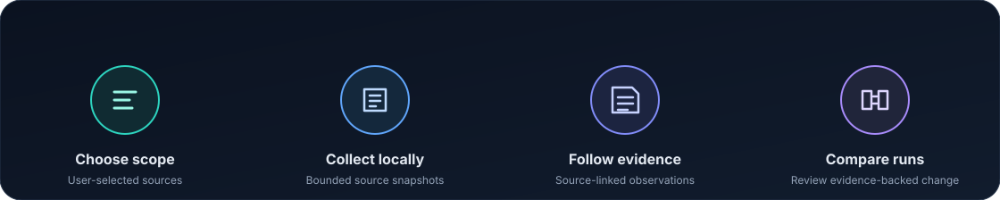

# SideEffect

SideEffect collects local software inventories and records what a selected command does during a bounded run. It keeps source records with the results so you can inspect what was observed and where it came from.

SideEffect is an on-demand audit tool. It does not continuously monitor your computer, run startup entries, upload audit data, or request administrator access automatically.



## Try a local audit

The examples below use the current source checkout. They collect package and startup snapshots around a short command run, and save a session you can inspect. Pick a new output directory each time. Keep it outside the selected directory being observed.

### Linux x86_64

Install Rust 1.85 or later and `strace` 6.8 or later. From the repository root:

```sh
cargo build --release --locked
observed="$(mktemp -d /tmp/sideeffect-observed.XXXXXX)"
session_parent="$(mktemp -d /tmp/sideeffect-session.XXXXXX)"
session="$session_parent/session"
./target/release/sideeffect audit \
  --output "$session" \
  --packages --startup \
  --observe-root "$observed" \
  --runtime-duration-seconds 10 -- /usr/bin/touch "$observed/marker.txt"
status=$?
printf 'audit exit status: %s\n' "$status"
./target/release/sideeffect inspect --format text --session "$session"
./target/release/sideeffect compare-observation "$session"
```

### Native Windows x64

Build with Rust 1.85 or later. ETW capture requires a token that can control the shared NT Kernel Logger; SideEffect will not elevate itself. From PowerShell, run the capture in an already-authorized session:

```powershell
cargo build --release --locked
$observed = Join-Path $env:TEMP ("sideeffect-observed-" + [guid]::NewGuid().ToString('N'))
$session = Join-Path $env:TEMP ("sideeffect-session-" + [guid]::NewGuid().ToString('N'))
New-Item -ItemType Directory -Path $observed -Force | Out-Null
.\target\release\sideeffect.exe audit `
  --output $session `
  --packages --startup `
  --observe-root $observed `
  --runtime-source windows-etw --runtime-duration-seconds 10 `
  -- "$env:SystemRoot\System32\whoami.exe"
$auditStatus = $LASTEXITCODE
"audit exit status: $auditStatus"
.\target\release\sideeffect.exe inspect --format text --session $session
.\target\release\sideeffect.exe compare-observation $session
```

Runtime capture starts the selected program with your permissions; it is not a sandbox. Windows ETW is system-wide for the capture window and can include unrelated activity. Capture completeness is unknown. Partial or unavailable sources are retained with diagnostics and can make a command exit with status `2`; inspect the saved session even when that happens. `compare-observation` reports evidence-linked differences, not causation.

Sessions and reports can contain paths, software details, command arguments, and raw runtime evidence. Keep them private and review them before sharing. See [installation and platform details](docs/INSTALL.md) for release installation, compatibility, and workflow limits.

## Install SideEffect

### Published release

The [GitHub Releases page](https://github.com/tengircik/SideEffect/releases) has the published v0.1.0 archives for Linux x86_64 and Windows x64. Release archives do not need Rust. Verify the archive checksum and build provenance before installing; follow the platform-specific steps in [docs/INSTALL.md](docs/INSTALL.md). The archive installation checks and their limits are recorded in [docs/RELEASE_ACCEPTANCE.md](docs/RELEASE_ACCEPTANCE.md).

The v0.1.0 archives are fixed release artifacts. This repository's current source includes later, unreleased workflows and session formats, including the observation commands shown above. Build the source checkout to use those newer workflows; do not assume they are in the v0.1.0 binaries.

### Build and install from source

With Rust 1.85 or later already installed, run from the repository root:

```sh
cargo install --path . --locked
sideeffect version
```

On Windows, the installed command is `sideeffect.exe`. Linux runtime tracing also requires `strace` 6.8 or later. More installation options are in [docs/INSTALL.md](docs/INSTALL.md).

## Use it with an AI coding agent

The `sideeffect-audit` Agent Skill teaches a compatible agent to use the local CLI. SideEffect does not require its optional local-model experiments for this workflow; the agent uses the model selected in that agent. Review the [skill instructions](.agents/skills/sideeffect-audit/SKILL.md) and [installation guide](docs/AGENT_SKILL.md) before installing.

With Node.js 22.20 or later, install the skill globally using the community `skills` installer. This command pins the skill to the reviewed source revision and disables installer telemetry:

```sh
DISABLE_TELEMETRY=1 npx skills add https://github.com/tengircik/SideEffect/tree/ea7c5ef17ca16263afb62026e36c42d135bf6de8/.agents/skills/sideeffect-audit -g --copy
```

PowerShell:

```powershell
$env:DISABLE_TELEMETRY = '1'
npx skills add https://github.com/tengircik/SideEffect/tree/ea7c5ef17ca16263afb62026e36c42d135bf6de8/.agents/skills/sideeffect-audit -g --copy
```

The skill is instructions, not the CLI. Install SideEffect separately and confirm that the agent sees the skill before asking it to use it. Runtime captures or opening raw, sensitive evidence require specific user confirmation in the skill workflow. Data returned to an agent may be handled by that agent's provider under its privacy settings.

## What it can inspect

SideEffect's collectors are bounded snapshots, not exhaustive system inventories.

- **Linux:** available package-manager records, visible process metadata, selected-path permissions, curated startup configuration, selected-directory metadata, and `strace` records for a selected command and its traced children.
- **Native Windows:** selected Uninstall and AppX/MSIX registrations, process metadata, selected-path permissions, curated startup configuration, and bounded ETW process, selected file, disk, and network observations. ETW capture needs permission to control the shared NT Kernel Logger.
- **Evidence review:** inspect saved sessions and traces, compare compatible snapshots or runs, and follow references to source records. Some workflows can create bounded static HTML reports.

Unsupported, inaccessible, malformed, and partial sources remain unknown or are marked not checked. Startup values and scripts are retained as inert evidence; SideEffect does not execute them. Runtime events describe observed records and do not prove that an operation succeeded unless its recorded result says so. Comparisons and associations are limited to their documented matching rules. Nothing here establishes root cause, complete coverage, or software safety. WSL2 is useful for Linux workflows but does not count as native Windows support.

## Documentation

- [Product scope and limits](docs/PRODUCT.md)
- [Build, install, and platform compatibility](docs/INSTALL.md)
- [Agent Skill installation and privacy](docs/AGENT_SKILL.md)
- [Architecture](docs/ARCHITECTURE.md)
- [Security policy and vulnerability reporting](SECURITY.md)
- [Release notes](docs/RELEASE_NOTES.md)
- [v0.1.0 archive acceptance record](docs/RELEASE_ACCEPTANCE.md)

## Contributing

Read [CONTRIBUTING.md](CONTRIBUTING.md) and [AGENTS.md](AGENTS.md) before changing the project. Keep captures, reports, and other private evidence out of commits.

## License

SideEffect is licensed under the [Apache License, Version 2.0](LICENSE).
