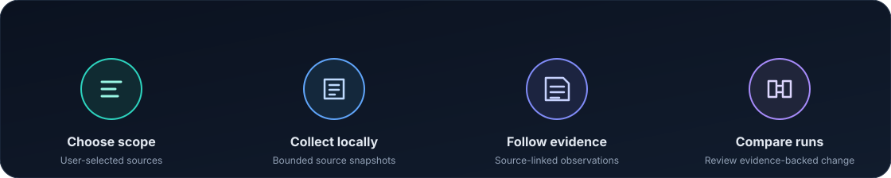

<div align="center">
  
  <h1>SideEffect</h1>
  <p><strong>See what software is configured to do. Inspect what a selected run actually did.</strong></p>
  <p>Local, evidence-linked software audits for Linux and Windows — from your terminal or your preferred AI coding agent.</p>
  <p>
    <a href="https://github.com/tengircik/SideEffect/actions/workflows/ci.yml"></a>
    <a href="LICENSE"></a>
    <a href="https://github.com/tengircik/SideEffect/releases/latest"></a>
    
    
  </p>
</div>

SideEffect turns selected local software sources and bounded runtime captures into evidence you can inspect, compare, and discuss. Every audit is initiated by you. Source status and diagnostics travel with the results, so the report shows how each observation was obtained.



## Start with your AI agent

Install the `sideeffect-audit` Agent Skill for Codex, Claude Code, Cursor, Gemini CLI, GitHub Copilot, OpenCode, Windsurf, and other agents supported by the Agent Skills installer. The skill lets your chosen agent use SideEffect's deterministic CLI; it does not require SideEffect's experimental local-model commands.

The install commands below pin the skill source to commit `ea7c5ef17ca16263afb62026e36c42d135bf6de8` so the reviewed instructions cannot silently change during installation.

### Install SideEffect through Codex, Claude Code, Cursor, or another agent

In Codex, Claude Code, Cursor, Gemini CLI, GitHub Copilot, OpenCode, Windsurf, or another compatible coding agent, share the repository **`tengircik/SideEffect`** and say **“Install this repo and leave SideEffect ready to use.”** Use the same request on each supported client, then paste the setup instructions below. The agent installs the skill for that client and the CLI for your operating system, then verifies both:

> Set up SideEffect from the GitHub repository `tengircik/SideEffect` for this agent. Read the repository's README, Agent Skill installation guide, and platform installation guide. Install the `sideeffect-audit` skill using the documented method for this agent, then install the SideEffect CLI using the documented method for this computer. Verify that `sideeffect version` works and that this agent discovers the skill. Do not run an audit. Do not install system toolchains or request administrator/root access; tell me if a prerequisite is missing.

The agent reads the repository's installation guide, installs the skill for its current client, installs the CLI using the supported method for your computer, and verifies both. It does not start an audit. This requires an agent that can access GitHub and run local setup commands. CLI installation from source requires Rust/Cargo 1.85 or later to already be installed; the agent must tell you if a prerequisite is missing. See the complete [Agent Skill installation guide](docs/AGENT_SKILL.md).

The community skill installer requires Node.js 22.20 or later. The [v0.1.0 release](https://github.com/tengircik/SideEffect/releases/tag/v0.1.0) provides Linux x86_64 and Windows x64 CLI archives; installing a release binary does not require Rust. The Windows archive passed fresh checksum, attestation, extraction, and invocation checks. The Linux checksum matched, but attestation verification and archive installation remain unverified; see the [release acceptance record](docs/RELEASE_ACCEPTANCE.md). The [installation guide](docs/INSTALL.md) shows checksum and build-provenance verification. To build from source instead, use the instructions below.

```sh
DISABLE_TELEMETRY=1 npx skills add https://github.com/tengircik/SideEffect/tree/ea7c5ef17ca16263afb62026e36c42d135bf6de8/.agents/skills/sideeffect-audit -g --copy
```

PowerShell:

```powershell
$env:DISABLE_TELEMETRY = "1"
npx skills add https://github.com/tengircik/SideEffect/tree/ea7c5ef17ca16263afb62026e36c42d135bf6de8/.agents/skills/sideeffect-audit -g --copy
```

The community `skills` installer detects supported clients and installs the skill in their native locations. To install it for every agent supported by that installer:

```sh
DISABLE_TELEMETRY=1 npx skills add https://github.com/tengircik/SideEffect/tree/ea7c5ef17ca16263afb62026e36c42d135bf6de8/.agents/skills/sideeffect-audit --agent '*' -g --copy
```

To choose specific agents, for example Codex, Claude Code, Cursor, and OpenCode:

```sh
DISABLE_TELEMETRY=1 npx skills add https://github.com/tengircik/SideEffect/tree/ea7c5ef17ca16263afb62026e36c42d135bf6de8/.agents/skills/sideeffect-audit --agent codex --agent claude-code --agent cursor --agent opencode -g --copy
```

For Oh My Pi (OMP), copy the reviewed skill folder to `.omp/skills/sideeffect-audit/`. Follow the complete [Agent Skill installation guide](docs/AGENT_SKILL.md) for OMP, project-local installation, updating, privacy, and verification.

The skill requires the SideEffect CLI. Build and install it from source:

```sh
git clone https://github.com/tengircik/SideEffect.git
cd SideEffect
cargo install --path . --locked
sideeffect version
```

Then ask your agent: **“Show me the startup entries visible to this account with SideEffect.”** The agent checks the installed CLI, selects the relevant source, and summarizes the status and evidence. Linux runtime recording also requires `strace` 6.8 or later. See [installation and platform details](docs/INSTALL.md).

## Or use the CLI directly

### Inspect startup configuration

```sh
sideeffect inventory startup --output ./startup.json
```

On Windows:

```powershell
sideeffect.exe inventory startup --output .\startup.json
```

The inventory retains source-linked configuration facts for supported startup locations, including XDG, systemd, SysV, and cron on Linux; Windows Run/RunOnce entries, Startup folders, visible services, Task Scheduler boot/logon triggers, and permanent WMI subscriptions from the local `ROOT\subscription` namespace. WMI query, command, and script strings remain inert evidence. Standalone Windows startup schema v7 adds a point-in-time SCM service-state observation, preserves unknown raw codes, and keeps WMI fields optional as an all-or-none extension. The observed service state does not establish that a startup entry caused it. Selecting `audit --startup` continues to use the existing envelope v10 and startup v6 contract; v7 audit-session integration remains open. Windows sessions without startup or App Paths and Linux sessions continue to emit v9; Windows sessions with App Paths emit v11.

On Windows, inspect registered executable path metadata with `sideeffect.exe inventory app-paths --output .\app-paths.json`. This reads only selected current-user and accessible machine App Paths registry entries. It does not scan disks, expand environment strings, or establish that a registered program exists or can be launched. Registry paths and names can be sensitive.

On Windows, inspect current-user AppX/MSIX package registrations with `sideeffect.exe inventory msix --output .\msix.json`. This reads bounded package metadata through the Windows package query API; it does not query other users, activate packages, inspect package files, or establish that a package is available, launchable, or has run. Package names, publishers, and installation locations can be sensitive.

To inspect the current process's executable-name candidates, run `sideeffect inventory path-executables --output ./path-executables.json` (PowerShell: `sideeffect.exe inventory path-executables --output .\path-executables.json`). It snapshots only the current process `PATH`, checks each listed directory one level deep, and never runs discovered files. Rows label candidates, non-candidates, and unknown entries. Linux uses regular files with an execute bit; Windows uses regular files whose suffix matches the captured `PATHEXT`. Empty components map to the current working directory and are recorded. Results are heuristic, preserve PATH order and observed directory enumeration order (which may vary between runs), and may be partial; paths and names can reveal local configuration.

To snapshot one selected directory's direct children, run `sideeffect inventory root --output ./root-before.json ./selected-directory` (PowerShell: `sideeffect.exe inventory root --output .\root-before.json .\selected-directory`). By default this bounded inventory reads metadata only. Add `--hash-regular-files` to opt in to schema v2 SHA-256 fingerprints for direct-child regular files. Files are limited to 16 MiB each and 64 MiB aggregate, with a five-second cooperative deadline; an in-flight filesystem read can extend the deadline. Symlinks/reparse points are never followed. Compare saved snapshots with `sideeffect explain --inventory-diff ./root-before.json ./root-after.json`; exact root path and child-name encodings are matched. Content differences are compared only when both snapshots observed hashes. Added/removed rows are shown only when both snapshots are complete and known local root identity hints do not conflict. A hint conflict suppresses unmatched rows but does not prove the root object changed. The comparison does not establish persistent object identity, installation, deletion cause, authenticity, or filesystem history. Exact paths, names, timestamps, sizes, local file-ID hints, and hashes can be sensitive.

The offline `explain --inventory-diff` command accepts same-platform Linux or Windows selected-root schema v1 and v2 snapshots. `audit --root PATH` stores metadata-only schema v1 by default; add `--hash-regular-files` to opt in to the bounded content fingerprints and schema v2. Session v8 introduced this artifact contract; v9 retains it, and v7 sessions remain readable with their historical v1 contract.

The same inventory can be selected inside an audit session with `sideeffect audit --output ./audit-session --path-executables` (PowerShell: `sideeffect.exe audit --output .\audit-session --path-executables`). On native Windows, add `--msix` to include a separate bounded snapshot of current-user MSIX package registrations; it does not activate packages or inspect package files. On native Windows, add `--app-paths` to snapshot selected App Paths registrations for session v11; comparison output contains hashed value fingerprints and source references instead of registry text. To also snapshot one selected directory and its direct children, add `--root ./selected-directory` (PowerShell: `--root .\selected-directory`). Add `--hash-regular-files` to explicitly read bounded direct-child regular-file content and include SHA-256 equality fingerprints; links/reparse points and nonregular files are not followed or hashed. Hashes and path metadata are sensitive and do not authenticate content. The session records status, limits, fixed artifact provenance, and collector identity. These point-in-time observations do not establish exhaustive coverage.

To compare two sessions that both include this source, run `sideeffect compare-sessions ./before-session ./after-session` (PowerShell: `sideeffect.exe compare-sessions .\before-session .\after-session`). PATH candidate changes use exact platform path encodings and evidence references. Selected-root changes compare direct-child metadata and compare content only when both sides observed hashes; missing hashes remain unknown and make the item comparison partial when hashing was requested. Different roots are incomparable. Incomplete sources and ambiguous identities suppress one-sided presence claims. A candidate label is a metadata heuristic, not proof that a shell resolves or can launch a file. Session artifacts and comparison output can contain sensitive paths, names, timestamps, sizes, hashes, and local file-ID hints.

When both Windows sessions include the optional `--app-paths` source, `compare-sessions` reports selected App Paths registration additions, removals, and changes. The output hashes registry values and registered names, retaining fixed source and entry references without displaying raw registry text. Incomplete sources, duplicate identities, or invalid identities suppress unmatched presence claims; a registration is not proof that a target exists or can launch. App Paths uses session envelope v11.

When both Windows sessions include the optional `--msix` source, `compare-sessions` reports current-user package registration additions, removals, and selected metadata changes using exact valid family-name evidence. Incomplete sources, duplicate identities, or any invalid identity suppress unmatched presence claims. A registration change does not establish package availability, health, launchability, or execution.

### Capture a selected Linux command

```sh
sideeffect record --trace ./capture.trace -- PROGRAM ARGUMENTS
sideeffect explain ./capture.trace
```

SideEffect passes the program and each argument separately. The selected command runs with your permissions. The trace is stored locally at the path you choose.

### Capture Windows runtime events

```powershell
sideeffect.exe audit --output .\session `
  --runtime-source windows-etw --runtime-duration-seconds 10 -- PROGRAM ARGUMENTS
sideeffect.exe inspect --format text --session .\session
```

The bounded ETW window records selected process, file, and network event families. Controlling the Windows Kernel Logger requires an already-administrative token; SideEffect never elevates automatically.

An existing validated ETW v3 capture can be reviewed with the experimental local evidence selector:

```powershell
$preview = sideeffect.exe model-explain-preview --question "Which network observation is recorded?" --backend cpu --windows-runtime .\runtime.windows.json | ConvertFrom-Json
sideeffect.exe model-explain --question "Which network observation is recorded?" --backend cpu --confirm-sha256 $preview.request_sha256 --windows-runtime .\runtime.windows.json
```

The ETW preview and result use their own schema versions. The selector can choose only exact preview event IDs. File, network, and disk payload observations appear only when SideEffect re-decodes retained bytes and matches the serialized sidecar; process payload fields are unknown when live TDH metadata is needed. Unsupported event-kind labels are marked as unverified capture metadata: the capture fingerprint detects representation changes but does not authenticate the capture. Event-header PID/TID values are context only. ETW capture completeness remains unknown, and this feature does not pass the local-model quality gate.

Local-model selection remains experimental; no model is approved for decisions. The [evaluation record](docs/LOCAL_MODEL_EXPLANATION_EVALUATION.md) describes the current quality limits and the identity-allowlisted review-packet tool for the Linux synthetic corpus. Native Windows ETW does not yet have a reviewed model-quality corpus.

### Adapt runtime evidence into a common event envelope

```sh
sideeffect events --trace ./capture.trace
```

On native Windows, a validated ETW capture can also be adapted:

```powershell
sideeffect.exe events --windows-runtime .\runtime.windows.json
```

The command writes versioned JSON to stdout and never runs represented commands or modifies the input. Events keep their source-local order, timestamps, outcome/status, and evidence links. Envelope v5 adds optional `path_observation` values tied to each event's source evidence. Linux paths are limited to parser-derived lexical hints; Windows names are emitted only when the FileIo sidecar exactly matches a re-decoding of its raw payload. These values are literal source spellings, not resolved filesystem identities. Envelope v5 also preserves source-local process observations and event links: Linux process-creation rows link the caller task ID to the returned child PID, while exact prefixed task-termination rows can split trace-task observations into source-local epochs on complete parses. These epochs are not OS process/PID generations or ancestry, and partial parses retain task-ID-only observations. Windows process start/end IDs are decoded from retained raw bytes only for reviewed Kernel-Process v0-v3 layouts and checked against the serialized TDH sidecar; image names remain decoder metadata only. For supported classic TCP/UDP rows, the adapter re-decodes retained raw payload bytes and checks the serialized observation; a mismatch is diagnosed and only the raw payload PID can support a context-candidate link. Unsupported or malformed payloads remain raw with an unresolved link and diagnostic. Windows file/disk header PIDs remain context candidates. These links do not form a merged process graph or causal view. A partial or unknown source exits with status `2`; the envelope does not infer one global clock or process ownership.

### Query runtime evidence

Create an exact-filter query file:

```json
{
  "schema": "sideeffect.event_query",
  "schema_version": 1,
  "filters": {
    "event_kind": "connect",
    "operation_kind": "syscall_attempt",
    "outcome": "failure"
  },
  "limit": 100
}
```

Schema v2 adds an optional exact path filter:

```json
{
  "schema": "sideeffect.event_query",
  "schema_version": 2,
  "filters": { "path_exact": "/tmp/example.txt" },
  "limit": 100
}
```

`path_exact` compares the full string exactly. It does not normalize separators or case, resolve `.`/`..` or symlinks, or perform glob/substring matching. Linux currently exposes hints only for supported `openat`/`openat2` trace spellings with a usable absolute base. Windows exposes a name only when a supported ETW FileIo name record has a validated raw-payload sidecar; many file events contain no path, and some observed Windows names may omit a drive letter. Unsupported, pathless, undecoded, or lost events cannot match. No match does not show that the path was not accessed. Schema v1 event queries remain accepted; `path_exact` requires schema v2. Query text output escapes terminal controls; JSON output remains ordinary data and may contain sensitive paths.

Schema v3 adds a literal string-prefix filter:

```json
{
  "schema": "sideeffect.event_query",
  "schema_version": 3,
  "filters": { "path_prefix": "/tmp/app" },
  "limit": 100
}
```

`path_prefix` is case-sensitive and compares the observed path spelling as text. For example, `/tmp/app` also matches `/tmp/apple`; this is not directory containment. Neither path filter resolves symlinks or canonicalizes paths. Query v1 and v2 remain accepted for their existing filters; event-query, session-result, and multi-session-result schemas are v3.

Apply it directly to a Linux trace or Windows ETW capture:

```sh
sideeffect query --query ./query.json --trace ./capture.trace
```

```powershell
sideeffect.exe query --query .\query.json --windows-runtime .\runtime.windows.json
```

Or query the verified runtime artifact in one audit session:

```sh
sideeffect query --query ./query.json --session ./audit-session --source runtime
```

```powershell
sideeffect.exe query --query .\query.json --session .\audit-session --source runtime
```

To search multiple verified sessions from the same native platform, repeat `--session` (2–16 sessions):

```sh
sideeffect query --query ./query.json --session ./before --session ./after --source runtime
```

```powershell
sideeffect.exe query --query .\query.json --session .\before --session .\after --source runtime
```

An optional `evidence` filter matches one complete source-native locator exactly. For Linux the locator contains `kind: "raw_trace_record"`, `line_number`, `byte_offset`, and `byte_length`; for Windows it contains `kind: "windows_etw_record"`, `record_ordinal`, `json_pointer`, and `raw_payload_sha256`. Copy the tuple from an event result when constructing the query. Evidence locators are exact tuple matches; path filtering is a separate schema-v2 feature with source-specific limits. Evidence locators and `process_observation_id` are source-local, so both are rejected across sessions. Each session's results stay nested under that session ID; event ordinals and evidence remain source-local. Multi-session queries cap aggregate runtime artifacts at 256 MiB, total matching rows at 5,000, a cooperative 10-second total-work budget checked between sessions, and output at 8 MiB. Session/source/capture/parse status and diagnostics remain separate. Linux `run.json` must bind `trace.strace` by exact schema, length, and SHA-256. Windows uses the session reader's verified ETW v3 artifact and validates its capture fingerprint. A missing or invalid selected session is an error; partial or unknown evidence exits `2`.

Query selected-root snapshots from one or more verified sessions with the separate `sideeffect.inventory_query` v1 contract:

```json
{
  "schema": "sideeffect.inventory_query",
  "schema_version": 1,
  "filters": {},
  "limit": 100
}
```

```sh
sideeffect query --query ./inventory-query.json --session ./audit-session --source selected_root
```

Repeat `--session` to query 2–16 sessions from the same native platform. Optional `root_path_hex` and `entry_name_hex` filters match exact native encodings: Linux path/name bytes or Windows UTF-16LE code units, with no display-name decoding or path normalization. The query accepts verified selected-root v1/v2 artifacts and preserves source status, diagnostics, artifact digest, and entry ordinals. Its bounded results cover only each selected root's one-level snapshot; zero matches do not establish system-wide absence. The install guide documents the PowerShell form and full limits.

### Explore an evidence-linked event graph

```sh
sideeffect graph --trace ./capture.trace --event-kind openat
```

On native Windows, adapt a validated ETW capture:

```powershell
sideeffect.exe graph --windows-runtime .\runtime.windows.json --event-kind file_io_observation
```

The graph contains source-local event and process-observation nodes, process-relationship edges, and event-to-process links. `--event-kind` matches one exact kind and keeps its direct process links plus one-hop process relationships; diagnostics and source status still describe the full input. Unresolved PID context is represented by a separate node for each edge; equal PID values are never merged into one process instance. Every node and edge retains its source evidence, link status, and derivation basis. Context candidates and decoder-metadata relationships stay labeled as such. The graph does not establish ownership, causation, or a complete process tree. Partial or unknown input exits with status `2`.

### Browse a source-local event timeline

```sh
sideeffect timeline --trace ./capture.trace --event-kind openat
```

On native Windows, use a validated ETW capture:

```powershell
sideeffect.exe timeline --windows-runtime .\runtime.windows.json --event-kind file_io_observation
```

To filter by a process observation from that same source, add `--process-observation ID`:

```sh
sideeffect timeline --trace ./capture.trace --process-observation PROC_OBS_ID
```

```powershell
sideeffect.exe timeline --windows-runtime .\runtime.windows.json --process-observation PROC_OBS_ID
```

The filters can be combined in either order; combined filters select events matching both the exact event kind and a direct link to that process observation. Process observation IDs are source-local identifiers, not PIDs, and are not portable across captures. The selected observation and its evidence remain present even when the combined filters select no events. The JSON listing keeps each source's original order, timestamp representation, and evidence reference, including every direct link for displayed events. Full-source diagnostics remain visible, and partial or unknown status exits with status `2`. An empty filtered result does not prove that the event or process activity was absent. Timelines are single-source views: they do not merge clocks or establish causal order. Hosted tests exercise the timeline adapter on real Linux `strace` and native Windows ETW captures for named file/loopback scenarios on Ubuntu 24.04 and Windows Server 2022/2025; they do not establish broad OS or event coverage.

On native Windows, resolve one ETW timeline or graph event directly to its validated source row using the capture fingerprint, record ordinal, and raw-payload digest from that reference:

```powershell
sideeffect.exe evidence --windows-runtime .\runtime.windows.json CAPTURE_SHA256 RECORD_ORDINAL RAW_PAYLOAD_SHA256
```

The command verifies all three reference values and returns the original event row with its JSON pointer, capture loss, and diagnostics. It does not independently verify serialized decode metadata or authenticate the producer. Unknown completeness and partial status are preserved and exit with status `2`.

### Compare saved inventories

Capture two inventories with the same platform's command, then compare the saved files:

```sh
sideeffect inventory packages --output ./before.json
sideeffect inventory packages --output ./after.json
sideeffect explain --inventory-diff ./before.json ./after.json
```

For Linux startup configuration, run:

```sh
sideeffect inventory startup --output ./startup-before.json
sideeffect inventory startup --output ./startup-after.json
sideeffect explain --inventory-diff ./startup-before.json ./startup-after.json
```

On Windows PowerShell, run:

```powershell
sideeffect.exe inventory startup --output .\startup-before.json
sideeffect.exe inventory startup --output .\startup-after.json
sideeffect.exe explain --inventory-diff .\startup-before.json .\startup-after.json
```

On Windows, use `sideeffect.exe inventory packages --output .\before.json` and `sideeffect.exe explain --inventory-diff .\before.json .\after.json`. The offline comparison accepts same-platform pairs of Linux package v2, Windows software-registration v1, Linux process v3-v5, Windows process v3-v4, Linux/Windows selected-path permission v1, Linux startup v2/v3, or Windows startup v4-v7 inventories. Permission rows match only by exact selected path bytes (Linux) or UTF-16LE path bytes (Windows); paths are not normalized. It compares bounded metadata and native ACL/capability or descriptor/ACE facts, keeps evidence references, and omits raw xattr/security descriptor bytes. Duplicate identities and incomplete inputs do not produce confident unmatched presence changes. It does not calculate effective access or establish that inode/file-index values identify a persistent object. Process rows are matched only by PID plus observed generation (Linux proc start ticks or Windows creation FILETIME), never PID alone. Linux v5 requires matching boot-ID and PID-namespace inode hints; Linux v4 has no PID-namespace identity, and Windows v3-v4 have no reviewed reusable host boot identity. Exact matches in those candidate domains can produce only `candidate_changed` field comparisons; unmatched additions/removals are suppressed. Linux v3 snapshots suppress all cross-snapshot deltas. These are bounded evidence hints, not host authentication or process history. Selected process facts preserve evidence references on both sides. Startup rows use native source-specific identities; task action rows are compared as an ordered sequence, and duplicate task triggers or lossy XDG display paths remain ambiguous. Startup output contains only hashed identities, changed-field labels, and before/after source references; raw commands/configuration values stay in the input files. A startup comparison does not establish that a configured entry was installed, removed, effective, or executed. These bounded outputs compare two snapshots, not start/exit or execution history, exhaustive inventory, causation, or proof of absence. PIDs, generation values, paths, and source references can be sensitive. Hashed identities are not anonymization and may be guessable for common paths or names. Incomplete sources or ambiguous identities suppress uncertain presence changes and produce exit status `2`.

For process snapshots, use `sideeffect inventory processes --output ./before.json` and `sideeffect inventory processes --output ./after.json` (or `sideeffect.exe` on Windows), then run the same `explain --inventory-diff` command. Linux v5 records a boot-ID and caller PID-namespace inode hint; Linux v4 has no namespace identity, and Linux v3 has no identity domain. Linux v4-v5 and Windows v3-v4 comparisons emit candidate field changes only for exact PID/generation matches and suppress unmatched presence; missing or mismatched Linux v5 domains and Linux v3 comparisons suppress all deltas. The hints are procfs evidence, not host authentication or durable process identity; cloned VM state may preserve boot IDs and namespace inodes can be reused. Process output includes local PIDs, generation values, and selected paths; review it before sharing.

### Keep evidence in a local investigation case

Create a private schema-v2 draft from one or more verified sessions on the same native platform:

```sh
sideeffect case init --output ./review.case.json --title "Review selected behavior" --session ./audit-session
```

On Windows, use `sideeffect.exe` and PowerShell paths. Repeat `--session` for additional sessions (up to 16). The case stores each session ID and SHA-256 of its exact manifest bytes. Add one note or assertion by preparing a bounded entry JSON file and writing a new case revision:

```json
{
  "id": "N001",
  "kind": "note",
  "authorship": "analyst_supplied_unverified",
  "text": "Review this observation",
  "evidence": []
}
```

```sh
sideeffect case add-entry --case ./review.case.json --entry ./note.json --output ./review-with-note.case.json --session ./audit-session
```

For assertions, include exact evidence locators copied from the relevant session artifact. Assertions remain analyst-supplied and unverified. The command verifies the supplied sessions and locators, preserves the source case, increments the branch-local revision, and writes a private output without overwriting an existing file. Repeat it with a new output path for each entry. Entries can be added only while the case is `draft` or `open`.

Move a case through its review states by writing new files. `draft` can become `open` or `cancelled`; `open` can become `in_review`, `closed`, or `cancelled`; `in_review` can return to `open` or become `closed` or `cancelled`. `closed` and `cancelled` are terminal. Status describes the analyst workflow and does not assess evidence quality or completeness:

```sh
sideeffect case set-status --case ./review-with-note.case.json --status in_review --output ./review-in-review.case.json --session ./audit-session
```

V1 case files remain readable and resolvable, but have no stored status. Migrate one explicitly by choosing its initial status; the migration preserves all entries and evidence locators, hashes the exact source bytes as the parent, and leaves the source file unchanged:

```sh
sideeffect case migrate --case ./legacy.case.json --status open --output ./review-v2.case.json --session ./audit-session
```

Resolve the locators against the same verified sessions:

```sh
sideeffect case resolve --case ./review.case.json --session ./audit-session
```

For a private, static HTML review report with links from each entry to its resolved evidence facts, use:

```sh
sideeffect case resolve --format html --output ./review.html --case ./review.case.json --session ./audit-session
```

The default command writes bounded JSON; HTML is static, offline, size-bounded, private, and never overwrites an existing file. Both formats retain case status/revision and source/session status. Exit status `2` means some source or capture remains partial or unknown. Manifest, artifact, and parent-case hashes establish byte consistency; they do not authenticate who produced the evidence or prove an assertion, and the parent hash does not prevent forks or rewrites. Entry authoring is one JSON entry at a time; there is no interactive editor or role-specific report set yet. Reports can contain sensitive paths, arguments, and event payloads; keep them local and review before sharing.

To preview exact whole-field omissions for an HTML export, select one or more groups. The preview prints only group names and affected field-occurrence counts and writes no report; rerun without `--preview-redaction` to write a separate redacted report:

```sh
sideeffect case resolve --format html --redact case-text --redact artifact-paths --redact source-records --redact evidence-identifiers --preview-redaction --case ./review.case.json --session ./audit-session
sideeffect case resolve --format html --redact case-text --redact artifact-paths --redact source-records --redact evidence-identifiers --output ./review-redacted.html --case ./review.case.json --session ./audit-session
```

These groups omit the named structured fields as a whole and leave the source case and evidence unchanged. `artifact-paths` also replaces values under the exact structured key `artifact_path` inside source records that remain in the report; unrelated keys such as `path` or `display_name`, and substrings in free text, remain untouched. The feature does not scan text for path, username, endpoint, credential, or other sensitive substrings and does not guarantee that an export is safe to share. Review the complete output before sharing.

`case-text` covers the case title and analyst entry text; `source-records` omits each resolved record block; `evidence-identifiers` omits the case/session identifiers and locator objects. Identifiers inside a retained source record remain unless `source-records` is also selected.

## What you can do

| Workflow | Evidence and output |
| --- | --- |
| Software inventory | Package-manager records on Linux and registered software entries on Windows, with source identifiers and collection status |
| Process snapshot | Visible process identity and executable-link or image-path evidence |
| Permission inspection | Linux mode, supported ACL, and file-capability evidence; Windows owner, group, and DACL evidence for paths you select |
| Selected-directory snapshot | Bounded metadata by default; optional SHA-256 fingerprints for selected direct-child regular files on Linux and Windows; no recursion |
| Startup discovery | Source-linked startup configuration, retained as inert values and scripts |
| Runtime capture | Linux `strace` records for a selected command and traced children; native Windows ETW events for a bounded capture window |
| Evidence review | Bounded JSON, terminal-safe text, exact source references, and static offline HTML reports where supported |
| Investigation case | Private v2 drafts, explicit v1 migration, status transitions, immutable no-clobber revisions, exact evidence-locator resolution, and linked static offline HTML review; interactive editing and role-specific reports remain open |
| Comparison | Evidence-backed trace and ETW differences, aggregate summaries, and conservative association candidates |
| Deterministic explanation | Source-aware `explain` summaries without a model dependency |
| Optional local model tools | Experimental, user-selected model workflows with reviewed previews; no model is release-approved |
| Agent workflow | A portable skill for using SideEffect through your preferred agent and model |

Inventory collectors expose their source, status, diagnostics, and limits. Comparisons preserve their matching rules and evidence references. A relationship is identified as a candidate when the available records support only a candidate match.

## Designed for evidence-first audits

- **Run locally on demand.** SideEffect collects only when you invoke a command and writes results to the destination you choose.
- **Trace each claim to its source.** Parsed records, derived comparisons, and association candidates retain references to source evidence.
- **Keep the collection bounded.** Commands use documented limits for inputs, records, output, and capture windows.
- **See collection status.** Inaccessible, unsupported, malformed, and limit-affected sources are reported in the result.
- **Protect local outputs.** Supported file writers publish without replacing an existing destination and apply user-only access controls.
- **Use your preferred agent.** The Agent Skill provides workflow instructions; your selected agent supplies the model and tool environment.

SideEffect does not run startup entries or scripts. It does not upload audit data or request elevation. Captures and reports can contain sensitive local details; review them before sharing. An agent provider may receive evidence returned to its model according to that provider's settings.

## Supported platforms

SideEffect provides a native Rust CLI for Linux x86_64 and Windows x64. The Linux workflow uses the external `strace` executable. The Windows runtime collector uses ETW. Linux CI validates the real `strace` workflow on Ubuntu 24.04; Windows Server 2022 and 2025 CI exercises live process, file, and loopback network ETW events. The [compatibility matrix](docs/INSTALL.md#compatibility-and-observation-matrix) lists the exact tested environments and source boundaries.

## Optional local models

Local-model analysis is optional and experimental; no model is approved for answer quality, and SideEffect works without one. `sideeffect model setup ID [--runtime EXISTING_FILE]` installs pinned catalog weights after exact license acceptance and selects the model for its task. If `--runtime` is supplied, the file must already have been obtained by you; setup validates its canonical regular file, size, and SHA-256 before the license prompt, never downloads or executes it, and saves it for the same task after the weights install successfully. For the explanation task, `sideeffect model doctor --task explanation` checks the configured runtime revision and readiness. Without `--runtime`, runtime setup remains available separately through `model runtime set`. See [local model setup and readiness](docs/LOCAL_MODEL_DOCTOR.md) and the [Windows explanation setup and limitations](docs/LOCAL_MODEL_WINDOWS_SETUP.md).

## Documentation

- [Build, install, and platform compatibility](docs/INSTALL.md)
- [Install SideEffect as an agent skill](docs/AGENT_SKILL.md)
- [Product scope](docs/PRODUCT.md)
- [Optional local model setup and readiness checks](docs/LOCAL_MODEL_DOCTOR.md)
- [Windows local explanation model setup](docs/LOCAL_MODEL_WINDOWS_SETUP.md)
- [Local model evaluation and external holdout protocol](docs/LOCAL_QUERY_PLAN_EVALUATION.md)
- [Bounded Windows GPU memory sampling for local models](docs/WINDOWS_LOCAL_MODEL_GPU_MEMORY_MEASUREMENT.md)
- [Architecture](docs/ARCHITECTURE.md)
- [Delivery plan](docs/PLAN.md)
- [Linux real-trace benchmark methodology](docs/TRACE_BENCHMARKING.md)
- [Security policy and private vulnerability reporting](SECURITY.md)
- [Release notes](docs/RELEASE_NOTES.md)

## Build from source

Requirements: Rust 1.85 or later and Cargo. On Linux, install `strace` 6.8 or later to use runtime capture. Build and install the CLI with:

```sh
cargo install --path . --locked
```

Run the current command guide:

```sh
sideeffect --help
sideeffect help startup
```

## Contributing

Read [CONTRIBUTING.md](CONTRIBUTING.md) and the repository's [agent guidance](AGENTS.md) before changing behavior. CI runs formatting, Clippy, Rust tests, a real Linux `strace` integration, Windows native tests, ETW acceptance, and the portable skill validator.

## License

SideEffect is licensed under the [Apache License 2.0](LICENSE).
