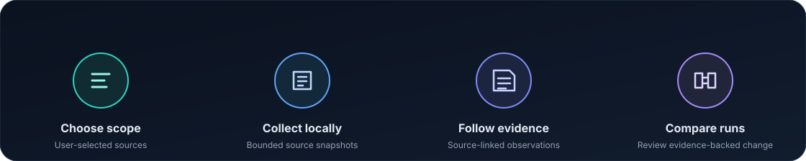

<div align="center">
  
  <h1>SideEffect</h1>
  <p><strong>See what software is configured to do. Inspect what a selected run actually did.</strong></p>
  <p>Local, evidence-linked software audits for Linux and Windows — from your terminal or your preferred AI coding agent.</p>
  <p>
    <a href="https://github.com/tengircik/SideEffect/actions/workflows/ci.yml"></a>
    <a href="LICENSE"></a>
    <a href="https://github.com/tengircik/SideEffect/releases/latest"></a>
    
    
  </p>
</div>

SideEffect turns selected local software sources and bounded runtime captures into evidence you can inspect, compare, and discuss. Every audit is initiated by you. Source status and diagnostics travel with the results, so the report shows how each observation was obtained.



## Start with your AI agent

Install the `sideeffect-audit` Agent Skill for Codex, Claude Code, Cursor, Gemini CLI, GitHub Copilot, OpenCode, Windsurf, and other agents supported by the Agent Skills installer. The skill lets your chosen agent use SideEffect's deterministic CLI; it does not require SideEffect's experimental local-model commands.

The install commands below pin the skill source to commit `ea7c5ef17ca16263afb62026e36c42d135bf6de8` so the reviewed instructions cannot silently change during installation.

### Install SideEffect through Codex, Claude Code, Cursor, or another agent

In Codex, Claude Code, Cursor, Gemini CLI, GitHub Copilot, OpenCode, Windsurf, or another compatible coding agent, share the repository **`tengircik/SideEffect`** and say **“Install this repo and leave SideEffect ready to use.”** Use the same request on each supported client, then paste the setup instructions below. The agent installs the skill for that client and the CLI for your operating system, then verifies both:

> Set up SideEffect from the GitHub repository `tengircik/SideEffect` for this agent. Read the repository's README, Agent Skill installation guide, and platform installation guide. Install the `sideeffect-audit` skill using the documented method for this agent, then install the SideEffect CLI using the documented method for this computer. Verify that `sideeffect version` works and that this agent discovers the skill. Do not run an audit. Do not install system toolchains or request administrator/root access; tell me if a prerequisite is missing.

The agent reads the repository's installation guide, installs the skill for its current client, installs the CLI using the supported method for your computer, and verifies both. It does not start an audit. This requires an agent that can access GitHub and run local setup commands. CLI installation from source requires Rust/Cargo 1.85 or later to already be installed; the agent must tell you if a prerequisite is missing. See the complete [Agent Skill installation guide](docs/AGENT_SKILL.md).

The community skill installer requires Node.js 22.20 or later. The [v0.1.0 release](https://github.com/tengircik/SideEffect/releases/tag/v0.1.0) provides verified Linux x86_64 and Windows x64 CLI archives; installing a release binary does not require Rust. The [installation guide](docs/INSTALL.md) shows checksum and build-provenance verification. To build from source instead, use the instructions below.

```sh
DISABLE_TELEMETRY=1 npx skills add https://github.com/tengircik/SideEffect/tree/ea7c5ef17ca16263afb62026e36c42d135bf6de8/.agents/skills/sideeffect-audit -g --copy
```

PowerShell:

```powershell
$env:DISABLE_TELEMETRY = "1"
npx skills add https://github.com/tengircik/SideEffect/tree/ea7c5ef17ca16263afb62026e36c42d135bf6de8/.agents/skills/sideeffect-audit -g --copy
```

The community `skills` installer detects supported clients and installs the skill in their native locations. To install it for every agent supported by that installer:

```sh
DISABLE_TELEMETRY=1 npx skills add https://github.com/tengircik/SideEffect/tree/ea7c5ef17ca16263afb62026e36c42d135bf6de8/.agents/skills/sideeffect-audit --agent '*' -g --copy
```

To choose specific agents, for example Codex, Claude Code, Cursor, and OpenCode:

```sh
DISABLE_TELEMETRY=1 npx skills add https://github.com/tengircik/SideEffect/tree/ea7c5ef17ca16263afb62026e36c42d135bf6de8/.agents/skills/sideeffect-audit --agent codex --agent claude-code --agent cursor --agent opencode -g --copy
```

For Oh My Pi (OMP), copy the reviewed skill folder to `.omp/skills/sideeffect-audit/`. Follow the complete [Agent Skill installation guide](docs/AGENT_SKILL.md) for OMP, project-local installation, updating, privacy, and verification.

The skill requires the SideEffect CLI. Build and install it from source:

```sh
git clone https://github.com/tengircik/SideEffect.git
cd SideEffect
cargo install --path . --locked
sideeffect version
```

Then ask your agent: **“Show me the startup entries visible to this account with SideEffect.”** The agent checks the installed CLI, selects the relevant source, and summarizes the status and evidence. Linux runtime recording also requires `strace` 6.8 or later. See [installation and platform details](docs/INSTALL.md).

## Or use the CLI directly

### Inspect startup configuration

```sh
sideeffect inventory startup --output ./startup.json
```

On Windows:

```powershell
sideeffect.exe inventory startup --output .\startup.json
```

The inventory retains source-linked configuration facts for supported startup locations, including XDG, systemd, SysV, and cron on Linux; Windows Run/RunOnce entries, Startup folders, visible services, and visible Task Scheduler boot/logon triggers. Configured commands remain inert evidence.

To inspect the current process's executable-name candidates, run `sideeffect inventory path-executables --output ./path-executables.json` (PowerShell: `sideeffect.exe inventory path-executables --output .\path-executables.json`). It snapshots only the current process `PATH`, checks each listed directory one level deep, and never runs discovered files. Rows label candidates, non-candidates, and unknown entries. Linux uses regular files with an execute bit; Windows uses regular files whose suffix matches the captured `PATHEXT`. Empty components map to the current working directory and are recorded. Results are heuristic, preserve PATH order and observed directory enumeration order (which may vary between runs), and may be partial; paths and names can reveal local configuration.

The same inventory can be selected inside an audit session with `sideeffect audit --output ./audit-session --path-executables` (PowerShell: `sideeffect.exe audit --output .\audit-session --path-executables`). The session records its status, limits, fixed artifact provenance, and collector identity. It remains a point-in-time candidate inventory: SideEffect does not execute candidates or resolve commands through a shell.

### Capture a selected Linux command

```sh
sideeffect record --trace ./capture.trace -- PROGRAM ARGUMENTS
sideeffect explain ./capture.trace
```

SideEffect passes the program and each argument separately. The selected command runs with your permissions. The trace is stored locally at the path you choose.

### Capture Windows runtime events

```powershell
sideeffect.exe audit --output .\session `
  --runtime-source windows-etw --runtime-duration-seconds 10 -- PROGRAM ARGUMENTS
sideeffect.exe inspect --format text --session .\session
```

The bounded ETW window records selected process, file, and network event families. Controlling the Windows Kernel Logger requires an already-administrative token; SideEffect never elevates automatically.

### Adapt runtime evidence into a common event envelope

```sh
sideeffect events --trace ./capture.trace
```

On native Windows, a validated ETW capture can also be adapted:

```powershell
sideeffect.exe events --windows-runtime .\runtime.windows.json
```

The command writes versioned JSON to stdout and never runs represented commands or modifies the input. Events keep their source-local order, timestamps, outcome/status, and evidence links. Envelope v2 adds source-local process observations and event links: Linux process-creation rows link the caller task ID to the returned child PID. Windows process identities and parent relationships come from serialized ETW decoder fields and are labeled `decoder_metadata_unverified`; linked event rows are context candidates because the offline adapter does not re-decode those fields from raw payload bytes. Windows file/disk header PIDs remain context candidates. These links do not form a merged process graph or causal view. A partial or unknown source exits with status `2`; the envelope does not infer one global clock or process ownership.

## What you can do

| Workflow | Evidence and output |
| --- | --- |
| Software inventory | Package-manager records on Linux and registered software entries on Windows, with source identifiers and collection status |
| Process snapshot | Visible process identity and executable-link or image-path evidence |
| Permission inspection | Linux mode, supported ACL, and file-capability evidence; Windows owner, group, and DACL evidence for paths you select |
| Startup discovery | Source-linked startup configuration, retained as inert values and scripts |
| Runtime capture | Linux `strace` records for a selected command and traced children; native Windows ETW events for a bounded capture window |
| Evidence review | Bounded JSON, terminal-safe text, exact source references, and static offline HTML reports where supported |
| Comparison | Evidence-backed trace and ETW differences, aggregate summaries, and conservative association candidates |
| Deterministic explanation | Source-aware `explain` summaries without a model dependency |
| Agent workflow | A portable skill for using SideEffect through your preferred agent and model |

Inventory collectors expose their source, status, diagnostics, and limits. Comparisons preserve their matching rules and evidence references. A relationship is identified as a candidate when the available records support only a candidate match.

## Designed for evidence-first audits

- **Run locally on demand.** SideEffect collects only when you invoke a command and writes results to the destination you choose.
- **Trace each claim to its source.** Parsed records, derived comparisons, and association candidates retain references to source evidence.
- **Keep the collection bounded.** Commands use documented limits for inputs, records, output, and capture windows.
- **See collection status.** Inaccessible, unsupported, malformed, and limit-affected sources are reported in the result.
- **Protect local outputs.** Supported file writers publish without replacing an existing destination and apply user-only access controls.
- **Use your preferred agent.** The Agent Skill provides workflow instructions; your selected agent supplies the model and tool environment.

SideEffect does not run startup entries or scripts. It does not upload audit data or request elevation. Captures and reports can contain sensitive local details; review them before sharing. An agent provider may receive evidence returned to its model according to that provider's settings.

## Supported platforms

SideEffect provides a native Rust CLI for Linux x86_64 and Windows x64. The Linux workflow uses the external `strace` executable. The Windows runtime collector uses ETW. Linux CI validates the real `strace` workflow on Ubuntu 24.04; Windows Server 2022 and 2025 CI exercises live process, file, and loopback network ETW events. The [compatibility matrix](docs/INSTALL.md#compatibility-and-observation-matrix) lists the exact tested environments and source boundaries.

## Documentation

- [Build, install, and platform compatibility](docs/INSTALL.md)
- [Install SideEffect as an agent skill](docs/AGENT_SKILL.md)
- [Product scope](docs/PRODUCT.md)
- [Architecture](docs/ARCHITECTURE.md)
- [Delivery plan](docs/PLAN.md)
- [Linux real-trace benchmark methodology](docs/TRACE_BENCHMARKING.md)
- [Security policy and private vulnerability reporting](SECURITY.md)
- [Release notes](docs/RELEASE_NOTES.md)

## Build from source

Requirements: Rust 1.85 or later and Cargo. On Linux, install `strace` 6.8 or later to use runtime capture. Build and install the CLI with:

```sh
cargo install --path . --locked
```

Run the current command guide:

```sh
sideeffect --help
sideeffect help startup
```

## Contributing

Read [CONTRIBUTING.md](CONTRIBUTING.md) and the repository's [agent guidance](AGENTS.md) before changing behavior. CI runs formatting, Clippy, Rust tests, a real Linux `strace` integration, Windows native tests, ETW acceptance, and the portable skill validator.

## License

SideEffect is licensed under the [Apache License 2.0](LICENSE).
